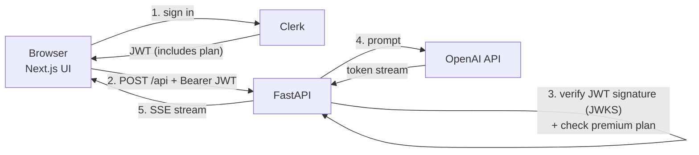

# MediNotes Pro — AI Consultation Assistant

Turn a doctor's rough visit notes into three ready-to-use documents in seconds, streamed live:

1. **A summary for the medical record**
2. **Next steps** as an actionable checklist
3. **An email to the patient** in plain language, in one of 6 languages

Built as my project for Ed Donner's [AI Engineer Production Track](#credits) course, then extended with my own features and hardening.

<!-- Add a screenshot or GIF here, e.g.  -->
<!-- Live demo: add the Vercel URL here -->

> ⚠️ Demo project for learning purposes only. It is not a medical device and must not be used with real patient data.

---

## Tech stack

| Layer | Technology |
|---|---|
| Frontend | Next.js 16 (Pages Router), React 19, TypeScript, Tailwind CSS v4 |
| Backend | Python, FastAPI, Pydantic |
| LLM | OpenAI API (`gpt-5-nano` by default, configurable), streamed with Server-Sent Events |
| Auth & billing | Clerk (sign-in, JWT verification, subscription plans via Clerk Billing) |
| Deployment | Vercel (serverless Python + static frontend) |

## Architecture



1. The user signs in with Clerk. Their session token is a signed JWT that also carries their subscription plan.
2. The frontend sends the visit data to the FastAPI backend with that token.
3. The backend verifies the token signature against Clerk's public keys and **checks the premium plan server-side**.
4. It builds the prompt and calls OpenAI with streaming enabled.
5. Each chunk is forwarded to the browser as a Server-Sent Event, and the UI renders it as it arrives.

## Features

- **Live streaming output**, split into three cards (summary, next steps, patient email) as the text arrives
- **Copy** each section, **download** the report as Markdown, or **print** it
- **Patient email language** selector (English, Spanish, Portuguese, French, German, Italian)
- **Stop generation** mid-stream
- **Sample notes** for a one-click demo, word and character counter, `Ctrl+Enter` to submit
- **Session history** kept in memory only (never written to browser storage, since it is health data)
- Responsive layout with dark mode
- **Subscription paywall** with Clerk Billing

## Engineering decisions

**The paywall is enforced in the backend, not just the UI.**
Hiding the form in the frontend is cosmetic: any signed-in user could call the API directly with their token. The backend reads the plan from the verified JWT (`pla` claim) and returns `403` without calling OpenAI if the user isn't on the premium plan. Because the JWT is signed by Clerk, a user can't edit it to add a plan.

**Robust streaming format.**
Each SSE event carries one JSON-encoded text chunk (`data: "line one\nline two"`). Newlines and spaces reach the browser exactly as the model produced them, with no fragile line-splitting tricks. The client also:
- sets `openWhenHidden: true`, so switching browser tabs doesn't silently re-send the request and double the LLM cost
- disables automatic retries on error, and shows clear error messages for `401` / `403` / `5xx`

**Input validation before spending tokens.**
Pydantic rejects invalid requests with a `422` before any OpenAI call is made: name and notes length limits, `YYYY-MM-DD` date format, and a whitelist of allowed languages.

**Structured output that the UI can rely on.**
The system prompt requires exactly three `###` sections. The frontend splits on those headings to build the cards, and falls back to rendering the raw Markdown if the model ignores the format.

**Configuration through environment variables.**
The model can be changed with `OPENAI_MODEL` without touching the code. No secrets are in the repo or in the frontend bundle.

## Project structure

```
├── api/
│   └── index.py          # FastAPI backend: auth, plan check, prompt, SSE streaming
├── components/
│   ├── Brand.tsx         # Logo and icons
│   └── ReportPanel.tsx   # Splits the streamed output into section cards + copy/download/print
├── pages/
│   ├── index.tsx         # Landing page
│   ├── product.tsx       # Consultation workspace (behind the paywall)
│   ├── _app.tsx          # ClerkProvider + global styles
│   └── _document.tsx
├── styles/globals.css    # Tailwind v4 + typography plugin, print styles
├── requirements.txt      # Python dependencies
└── package.json
```

## Environment variables

| Variable | Where | Description |
|---|---|---|
| `NEXT_PUBLIC_CLERK_PUBLISHABLE_KEY` | Frontend (build time) | Clerk publishable key (`pk_…`) |
| `CLERK_SECRET_KEY` | Backend | Clerk secret key (`sk_…`) |
| `CLERK_JWKS_URL` | Backend | Clerk JWKS URL, used to verify JWT signatures |
| `OPENAI_API_KEY` | Backend | OpenAI API key |
| `OPENAI_MODEL` | Backend, optional | Defaults to `gpt-5-nano` |

Locally they go in `.env.local`, which is git-ignored. On Vercel, add them in the project settings.

## Deploy to Vercel

1. Create a Clerk application and enable Billing with a plan whose slug is `premium_subscription`.
2. Import this repo in Vercel and add the environment variables above.
3. Deploy. Vercel builds the Next.js frontend and serves `api/index.py` as a Python serverless function at `/api`.

## Credits

This project was built while taking **Ed Donner's AI Engineer Production Track** course on Udemy ("AI in Production: Deploy Gen AI and Agentic AI at Scale"). The course provided the base architecture: Next.js + FastAPI on Vercel, streaming, Clerk auth and billing. Huge thanks to [Ed Donner](https://edwarddonner.com) ([GitHub](https://github.com/ed-donner)) for an excellent, hands-on course.

On top of the course version I added the redesigned UI, the section cards with copy/download/print, multi-language patient emails, stop/retry handling, server-side plan enforcement, input validation and the JSON streaming format.
